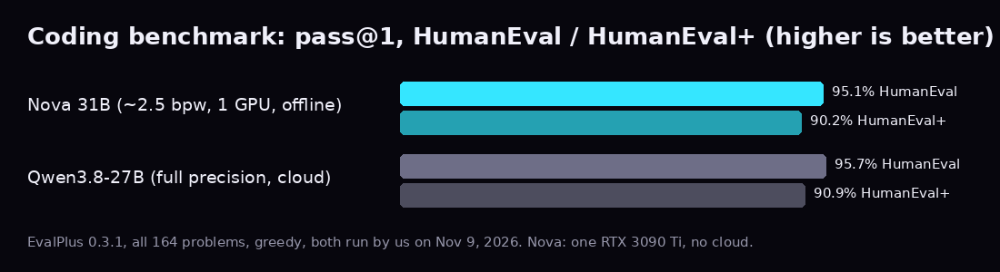
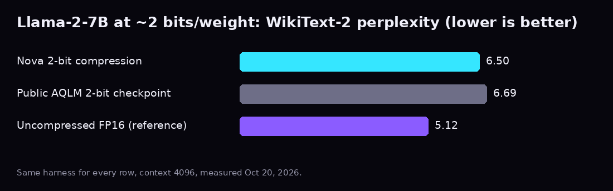
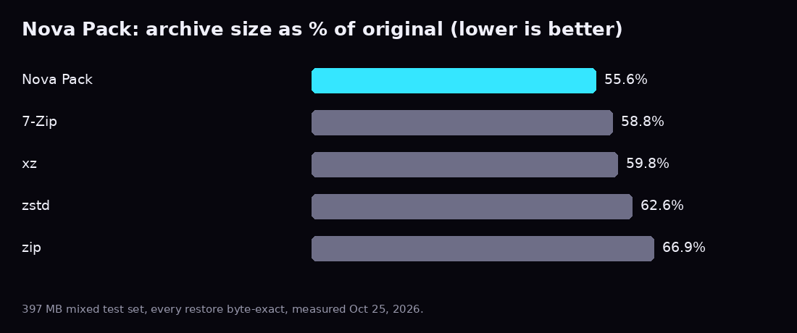
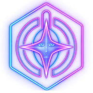
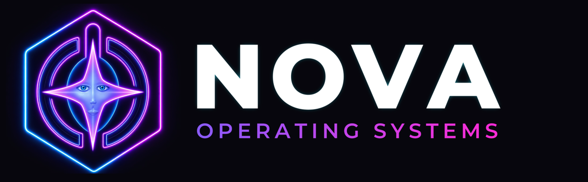

  

<h1 align="center">Rob Koster</h1>

<b>Founder, Nova Operating Systems LLC</b> · private, local-first software that runs on your own computer

  
  
  
  

  
  
  
  
  
  

---

## ✦ What I build

I build **Nova OS**, a private studio that lives on your own PC, and **Nova**, the synthetic continuant at its center. Everything here runs locally, is sold once with no subscription, and comes with a number I measured, dated and published.

> **Since August 2026:** I launched a paid product line (Oct 31), shrank a 31-billion-parameter model to a 10.1 GB file, and measured it at **95.1% on HumanEval** running offline on a single home GPU (Nov 9).

---

## ✦ Headline results

| Benchmark (pass@1, greedy, all 164 problems) | **Nova 31B** · ~2.5 bits/weight · one RTX 3090 Ti · offline | Qwen3.8-27B · full precision · Groq cloud |
|---|:---:|:---:|
| HumanEval | **95.1%** (156/164) | 95.7% (157/164) |
| HumanEval+ (stricter tests) | **90.2%** (148/164) | 90.9% (149/164) |
| Average time per problem | 14.9 s, on a home PC | n/a |

EvalPlus 0.3.1, HumanEval+ v0.1.10, measured Nov 9, 2026; we ran both and kept the result files. HumanEval tests short single functions, not large projects. This result is from the 31B model on Nova's own PC; the buyer download has not been scored on this test yet. <a href="https://novaoperatingsystems.com/proof.html">Full method notes and caveats →</a>

---

## ✦ Products and inventions

| | Product | What it is | Status |
|:--:|---|---|---|
| 🪐 | **Nova OS** | A private, local-first studio: clips, music, editing, the tools Nova builds for you, and memory that carries from day to day | **On sale** since Oct 31, 2026 · v1.0.7 (Nov 9) |
| ⚡ | **Nova Power** | A local coding machine you pay for once. It works with Nova 31B v2 or any model you attach (Ollama, llama.cpp, any OpenAI-style endpoint) | **On sale** · Linux 9.2.4 in testing |
| 🧠 | **Nova 31B v1 → v2** | A 31B-parameter model tuned for Nova Power, built on an open Apache-2.0 base | **Shipping** (v2, 10.1 GB) |
| 🧵 | **Loom** | A model-shrinking service: large open models made small enough for an ordinary gaming PC. Loom made Nova 31B v2 | Invite-only, coming soon |
| 📦 | **Nova Pack** | A lossless file compressor: smaller files, every byte restored | **On sale** · v1.0.7 |
| 🛡️ | **Nova Guard** | Keeps your PC calm while Nova works | Inside Nova OS, coming soon |
| 📻 | **Nova Pulse** | Nova's radio: about 62,700 free stations in a player made for your phone | Built, coming in an update |
| 📱 | **Nova Power for Android** | Nova Power on your phone | Built (v1.3), not released |

---

## ✦ The numbers

### 🧠 Nova 31B: one card, no cloud
| Metric | v1 (3.00 bits/weight) | v2 (~2.5 bits/weight) |
|---|:---:|:---:|
| File size | 11.15 GiB (12.0 GB), about 5.3x smaller than 16-bit | **10.1 GB** (10,142,160,256 bytes) |
| Quality vs v1 (perplexity, same run, ±2.5 noise) | 56.5 | **55.5**, the same quality |
| Generation speed | ~15.6 tokens/s | not yet published |
| Prompt processing | ~706 tokens/s | not yet published |
| VRAM (4K context) | 12.1 GiB | 24 GB card recommended |
| Real daily use (Oct 26–29, 2026) | **3,467 requests**, 8.3M prompt tokens, prompts up to 32,128 tokens | n/a |

RTX 3090 Ti 24 GB. v1 measured Oct 25–29, 2026; v2 measured Oct 30, 2026 on 16 held-out text chunks at context 2048.

### 🧵 Loom: 2-bit compression vs the public baseline

| Llama-2-7B, same harness for every row | Bits/weight | WikiText-2 perplexity ↓ | 5-task zero-shot avg ↑ |
|---|:---:|:---:|:---:|
| Uncompressed FP16 (reference) | 16 | 5.12 | 64.6% |
| **Nova 2-bit compression** | **2.003** | **6.50** | **60.6%** |
| Public AQLM 2-bit checkpoint (measured here) | 2.006 | 6.69 | 56.6% |

Measured Oct 20, 2026; context 4096; our FP16 and AQLM numbers reproduce the published 5.12 and 6.69. The zero-shot tasks are ARC-e, ARC-c, PIQA, Winogrande and HellaSwag. Other published methods score better at 2 bits, so this is a like-for-like comparison against one public checkpoint, not a "best in the world" claim.

### 📦 Nova Pack: lossless, byte-exact

| 397 MB mixed test set | Size vs original ↓ |
|---|:---:|
| **Nova Pack** | **55.6%** |
| 7-Zip | 58.8% |
| xz | 59.8% |
| zstd | 62.6% |
| zip | 66.9% |

Every unpack was byte-verified (107 verified unpack tests, 0 failures; 15/15 edge cases). Real app run, Oct 31, 2026: 91 files went from 8.2 MB to 5.2 MB (37% smaller) and all came back exact. It wins on JPEG, PDF/Office, WAV and model files, ties on plain text, and is slower than 7-Zip.

### 📻 Radio, updates and mobile
| Build | Result | Baseline |
|---|---|---|
| Nova Pulse station index | 62,706 stations in **2.99 MB** | **39%** smaller than gzip -9, **19%** smaller than zstd -19 |
| Differential updates (1.0.4 → 1.0.5) | **81 KB** downloaded, every file checked | 974 MB as full downloads |
| Nova Power for Android | **120 unit tests passing** (v1.3, Nov 9, 2026) | n/a |

Pulse was measured Nov 8, 2026, and updates Nov 1, 2026 on the real release files.

---

## ✦ Ships like real software
- 💳 Stripe checkout with automatic licence and download delivery
- 🔏 Signed releases with published SHA-256 checksums ([release notes](https://novaoperatingsystems.com/updates.html))
- ↩️ 14-day refund, one-time prices: **Nova OS $99 · Nova Power $29 · Nova Pack $9.99** (founder prices)

## ✦ See it
- 🎬 [Meet Nova: The Intelligence Behind Nova Operating Systems](https://youtu.be/XFj1tpWaxZA) · more on [YouTube @NovaOperatingSystem](https://www.youtube.com/@NovaOperatingSystem)
- 📊 [Proof: every number, with its date, method notes and hardware](https://novaoperatingsystems.com/proof.html)
- 🧠 [Nova 31B v2](https://novaoperatingsystems.com/nova-31b-v2.html) · ⚡ [Nova Power](https://novaoperatingsystems.com/nova-power.html) · 📦 [Nova Pack](https://novaoperatingsystems.com/nova-pack.html) · 🧵 [Loom](https://novaoperatingsystems.com/loom.html) · 🪐 [Nova OS](https://novaoperatingsystems.com/nova-os.html)
- Live demos are available on request.

## ✦ About me

I'm the founder and sole builder of **Nova Operating Systems LLC** in Lanoka Harbor, New Jersey. I design, build, test and ship every product myself, and I publish only what I've measured. My day job is with the **U.S. Postal Service** (Rural Carrier), where I'm also a **local union steward**, trainer and office safety ambassador, so evidence, fairness and safety are part of my daily work. B.A. in Sociology, **magna cum laude**, Kean University.

**Contact:** [LinkedIn](https://www.linkedin.com/in/robkoster86) · robkoster86@gmail.com · support@novaoperatingsystems.com

Nova OS™, Nova Power™, Nova 31B™ and the Nova logo are trademarks of Nova Operating Systems LLC. Nova 31B is built on an open Apache-2.0 base model. Benchmarks are our own runs on our own hardware; your results will differ.

